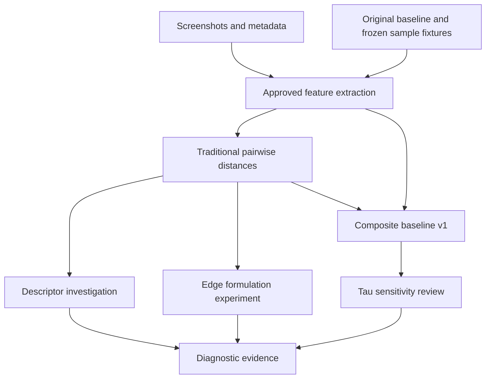

# Pipeline architecture

Descriptor and edge experiments are diagnostic branches. They do not automatically select parameters or gate composite execution on fabricated accuracy. The user has already selected M1 provisionally; tau=10 and equal group weights remain explicit assumptions.

## Routing

`pipeline.py --stage all` validates/reuses saved outputs. `--stage <name>` limits the requested responsibility to one module. `--recompute` executes that stage or the full ordered set with the same Python interpreter. No unnecessary extraction occurs in reuse mode. The orchestrator validates prerequisite records before executing a dependent stage and validates generated artifacts before downstream promotion.

The root `SKILL.md` routes to six module instructions. Shared source remains under `runtime/` because legacy scripts import each other by project-relative names; duplicating helpers into six script folders would create divergent implementations. Module skills are independently invocable responsibilities within one ecosystem, not six disconnected standalone Python distributions. Each points to its real entry point and the common data contract.

## Isolated execution

1. Check that the destination is fresh and outside the input project. Read all required fixture paths from `provenance.json`; report missing paths before launch. For bundled runtime inputs, verify packaged hashes.
2. Copy the declared runtime files to `<output>/workspace/`. Do not copy `.git`, environments, graph outputs, caches or new runs.
3. Verify original input digests and relocate absolute paths in the private `results_pairwise_baseline/configuration.json`. Record both old/new path maps in `relocation.json`. Numerical CSVs are unchanged.
4. Reuse validated canonical artifacts by default. For recomputation, launch existing scripts in subprocesses into `workspace/artifacts/<stage>/`, capturing a stage log at the run root.
5. For generated extraction/pairwise/composite stages, move prior canonical private copies to `workspace/reference/<stage>/` and copy validated generated artifacts into the private canonical location. Later stages therefore consume the new upstream results. The bundled runtime and original thesis remain untouched.
6. Record exact stage locations, reuse/recompute status, checks and source provenance in `run_manifest.json`. Verify input files remained unchanged. A failed stage stops dependent stages and leaves its log/workspace for investigation; it does not overwrite or resume an old run silently.

The pipeline does not change the legacy parameter interfaces or accept arbitrary new mathematical settings. Optional `--project` selects a complete compatible pilot project as donor; choose an output outside it. It does not magically supply missing fixtures. All current contracts intentionally enforce the known 82-screen/709-pair universe.

## Output interpretation

The canonical bundled outputs are frozen references. Recomputed figures use a portable font and can differ in bytes from older macOS renders even when numbers match. Pairwise/composite configurations contain new working paths and source hashes by design. Compare numerical records and declared parameters separately from location/rendering changes.

Descriptor/edge/composite narrative Markdown is historical interpretation copied with an explicit provenance marker; no new expert review is implied. Original screenshots and figures are supplied for manual visual inspection. The tau report is actually regenerated from saved/current composite tables. No G1/G2/G3 score or graph infrastructure is executed.
