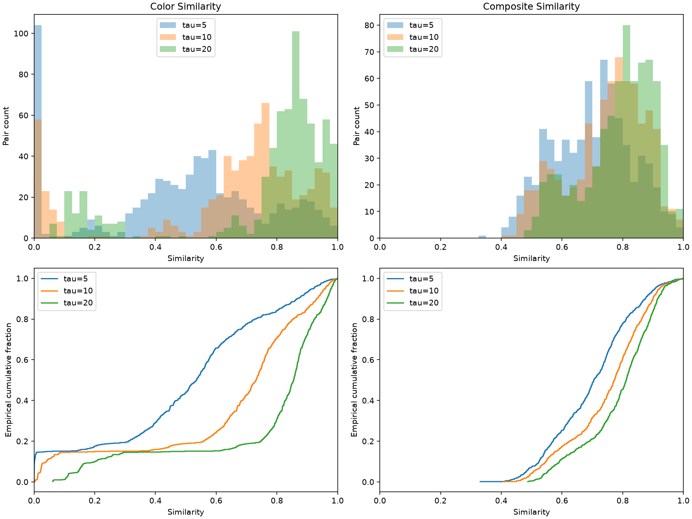
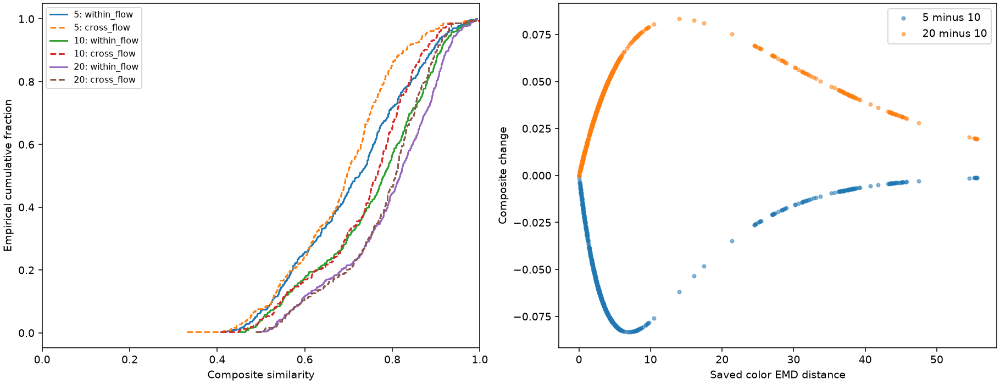

# Color normalization tau sensitivity review

**Decision: retain τ=10 as a provisional baseline.** All three requested M1 configurations were already present and numerically coherent. No missing configurations were calculated, and no extraction, edge experiment, color transport or baseline scoring run was launched. The review summarizes existing saved results; formula evaluation is used only to check them.

## Scope and validation

Read `sensitivity_analysis.csv`, `composite_scores.csv`, `configuration.json` and the existing `validation_report.md`. Reviewed the same 709 unique within-application pairs: 411 within-flow and 298 cross-flow. Pair IDs match the original pairwise universe and approved composite table. Each tau configuration has exactly one record per pair; tau=10 matches every baseline column exactly. M0 rows are excluded.

Across τ=5,10,20, raw color EMD, foreground/edge fractions, M1 edge similarity, Density, Layout, identifiers and non-color contributions are fixed. Saved density aggregation and composite arithmetic agree with the equal-weight formulas within absolute tolerance 10⁻¹⁵. All similarity outputs are finite in [0,1]. These numerical checks do not establish perceptual validity. Source hashes and historical-file preservation checks are in [checks.json](tau_review_assets/checks.json).

## Composite distributions

| τ | Pairs | Mean | Median | Min | Max | Sample SD |
| --- | --- | --- | --- | --- | --- | --- |
| 5 | 709 | 0.699146 | 0.704679 | 0.330782 | 1.000000 | 0.130046 |
| 10 | 709 | 0.748485 | 0.772447 | 0.406668 | 1.000000 | 0.127723 |
| 20 | 709 | 0.786893 | 0.812025 | 0.487177 | 1.000000 | 0.116702 |

Reducing τ from 10 to 5 lowers the mean by .049339 and the median from .772447 to .704679. Increasing it to 20 raises the mean by .038408 and median to .812025. Across τ=5 to 20, the mean changes by .087746. These are material score-scale effects, not grounds to prefer the highest-scoring configuration.

## Color similarity distributions

| τ | Mean | Median | Min | Max | Sample SD | q10 | q25 | q75 | q90 |
| --- | --- | --- | --- | --- | --- | --- | --- | --- | --- |
| 5 | 0.497719 | 0.535416 | 0.000015 | 1.000000 | 0.275733 | 0.001673 | 0.365443 | 0.682406 | 0.866690 |
| 10 | 0.645734 | 0.731721 | 0.003848 | 1.000000 | 0.284358 | 0.040902 | 0.604519 | 0.826079 | 0.930961 |
| 20 | 0.760958 | 0.855407 | 0.062030 | 1.000000 | 0.258403 | 0.202240 | 0.777508 | 0.908889 | 0.964863 |

Larger tau compresses a given distance penalty toward one. Background-dominated palettes and spatially different screenshots with similar color distributions remain descriptor limitations under every tau. Full statistics for Color and Composite by pair type are in [summary.csv](tau_review_assets/summary.csv).

The plots use fixed [0,1] similarity axes and .025-wide histogram bins. Histogram vertical scales differ between Color and Composite; they count pairs, not accuracy.

## Rankings

| τ | Reference τ | Composite Spearman | Mean absolute rank shift | Max rank shift | Max absolute score change |
| --- | --- | --- | --- | --- | --- |
| 5 | 10 | 0.992927 | 18.795487 | 75.000000 | 0.083333 |
| 20 | 10 | 0.993936 | 16.988717 | 68.000000 | 0.083328 |
| 20 | 5 | 0.976801 | 34.727786 | 143.000000 | 0.157488 |

Global rankings are strongly correlated but not identical. Relative to tau=10, average absolute shifts are about 19 places for tau=5 and 17 for tau=20, with maxima of 75 and 68 among 709 positions. Across tau=5 and 20, the larger ranking changes are reported above. Thus overall order is fairly stable while individual positions remain sensitive; no statistical/perceptual cutoff is assigned to “substantial.” In exact arithmetic, the strictly monotone color mapping preserves raw-distance ordering. Stored floating-point Color Spearman correlations are approximately 0.99999998–0.99999999 pooled, and 1 within each pair type; tiny differences in rounded ties cause maximum average-rank changes of .5. This is numerical tie behavior, not meaningful color-order discrimination. Composite ranks can change because the unchanged Density and Layout terms trade off against the altered Color term. [rank_changes.csv](tau_review_assets/rank_changes.csv) also reports each pair type.

## Most affected pairs

Largest absolute score change for each comparison (the first tau minus the reference tau):

| τ | Reference τ | Screen A | Screen B | Raw color EMD | Composite | Reference composite | Change |
| --- | --- | --- | --- | --- | --- | --- | --- |
| 5 | 10 | APP01-FLOW01-S015 | APP01-FLOW01-S05 | 6.945112 | 0.582491 | 0.665824 | -0.083333 |
| 20 | 10 | APP05-FLOW01-S04 | APP05-FLOW02-S04 | 14.020370 | 0.757550 | 0.674222 | 0.083328 |
| 20 | 5 | APP01-FLOW01-S015 | APP01-FLOW01-S07 | 9.297129 | 0.708433 | 0.550945 | 0.157488 |

[most_affected_pairs.csv](tau_review_assets/most_affected_pairs.csv) includes the five largest score changes and a largest-rank-shift example for each comparison. These are purposive numerical diagnostics, not a random sample or human judgments. Score-shift extremes need not coincide with rank-shift extremes.

APP03-FLOW02-S01 / APP03-FLOW02-S06 has the largest tau=5 versus 10 rank movement (−75) and tau=20 versus 10 movement (+68): scores .770207, .797390 and .811969 for tau=5,10,20, respectively. Existing original-image inspection sheets [page 11](inspection_sheets/page_11.png) and [page 12](inspection_sheets/page_12.png) show this welcome/login versus password-form pair; those sheets are reused, not regenerated. This numerical review does not collect new expert labels or independently re-review every screenshot.

## Within-flow versus cross-flow

| τ | Pair type | Pairs | Mean | Median | Min | Max | Sample SD |
| --- | --- | --- | --- | --- | --- | --- | --- |
| 5 | within_flow | 411 | 0.710219 | 0.722799 | 0.408860 | 0.990763 | 0.135966 |
| 5 | cross_flow | 298 | 0.683874 | 0.695781 | 0.330782 | 1.000000 | 0.119964 |
| 10 | within_flow | 411 | 0.755821 | 0.779346 | 0.450397 | 0.992364 | 0.132826 |
| 10 | cross_flow | 298 | 0.738367 | 0.764210 | 0.406668 | 1.000000 | 0.119815 |
| 20 | within_flow | 411 | 0.791793 | 0.817027 | 0.490663 | 0.993168 | 0.121130 |
| 20 | cross_flow | 298 | 0.780134 | 0.806979 | 0.487177 | 1.000000 | 0.110147 |

Both groups move in the same direction as tau increases. Cross-flow mean changes are −.054492 at tau=5 and +.041768 at tau=20 relative to 10; within-flow changes are −.045602 and +.035972. Different raw-color-distance compositions explain different aggregate shifts; flow membership is not a score input and is not a causal explanation. These overlapping pairs share screens, and applications contribute unequal pair counts. Descriptions do not constitute independent-sample inference, consistency comparisons or accuracy estimates.

## Formulas and notation

A and B denote screenshots. d=dC(A,B)≥0 is their saved weighted CIEDE2000-EMD color distance. τ>0 is the decay scale in the same distance units as d; exp denotes the natural exponential and log its inverse. Color similarity is Cτ=exp(−d/τ). At d=τ it equals exp(−1), approximately .367879, which defines a scale, not a consistency threshold. No dataset min-max normalization is used.

Let fA,fB be saved foreground fractions and eA,eB the saved Canny edge fractions. F=1−|fA−fB|, where vertical bars denote absolute value. E=min(eA,eB)/max(eA,eB) if the maximum is positive; otherwise E=1. Exactly one zero gives E=0. Density similarity is D=(F+E)/2. Let uA,k,uB,k be saved layout union occupancies for cell k=0,…,31 of the four-column/eight-row grid. Layout similarity is L=1−(Σk|uA,k−uB,k|)/32, where Σk sums over those cells. The composite is Xτ=(Cτ+D+L)/3=Cτ/3+F/6+E/6+L/3. Thus only the color contribution changes in this review.

For positive tau values a and b, the score difference is Δ(a,b)=Xa−Xb=(exp(−d/a)−exp(−d/b))/3. Keeping d fixed, the rate of change with tau is ∂Xτ/∂τ=d exp(−d/τ)/(3τ²)≥0; ∂ denotes differentiation. Scores must increase or remain unchanged when tau rises, but higher scores are not evidence of improved modeling. For a<b, the largest possible absolute difference over nonnegative d occurs at d*=ab log(b/a)/(b−a); the asterisk denotes the maximizing distance, not an observed annotation. This follows by setting the derivative of the difference with respect to d to zero. It approaches zero at d=0 and as d grows without bound.

For 5 versus 10, d*≈6.931472; for 10 versus 20, d*≈13.862944. Each has theoretical maximum composite change 1/12≈.083333. For 5 versus 20, d*≈9.241962. The observed extreme pairs lie near these distances. Consequently, intermediate raw color distances can be more tau-sensitive than the largest EMD values. Sensitivity does not identify an optimal tau.

For n pairs with score xi, mean μ=(Σi xi)/n and sample standard deviation s=sqrt(Σi(xi−μ)²/(n−1)), where i indexes the group, Σi sums over it and sqrt denotes square root. Minimum and maximum are observed extrema. Quantiles use NumPy linear interpolation: for ascending zero-based values x(0),…,x(n−1), let t=(n−1)p, j=floor(t), g=t−j and Q(p)=(1−g)x(j)+g x(j+1), returning the final endpoint directly. Floor rounds down. Median uses p=.5; q10,q25,q75,q90 use p=.10,.25,.75,.90.

The empirical cumulative distribution at z is H(z)=(1/n)Σi I(xi≤z), with I equal to 1 if its condition holds and 0 otherwise. Histograms use the fixed bins described above, with the final bin including 1. Descending rank Ri,τ gives the position of pair i for tau τ, assigning average positions to ties; a negative rank change means movement toward rank 1. Within-type rank summaries recalculate ranks inside their own group. Spearman correlation is the Pearson correlation of average ascending ranks ri and ti: ρ=Σi(ri−r̄)(ti−t̄)/sqrt(Σi(ri−r̄)²Σi(ti−t̄)²), where bars denote mean ranks. Rank direction reversal in both inputs leaves this correlation unchanged. No p-values or independence claims are used.

## Findings and decision

1. **Score sensitivity:** tau materially shifts absolute color/composite values, with a bounded per-pair effect under these fixed weights. It does not change extracted features.
2. **Ranking sensitivity:** high Spearman correlations show broadly stable ordering; changes of up to 75/68 positions relative to 10 remain meaningful to disclose. No claim of perceptual ranking improvement follows.
3. **Affected pairs:** intermediate raw color EMD values produce the largest score shifts; largest rank shifts additionally depend on Density, Layout and neighboring pairs' scores. The linked pair table identifies the actual screens.
4. **Retain τ=10 provisionally:** no serious numerical or methodological inconsistency was detected in the existing three configurations. Tau=10 remains a transparent middle sensitivity setting, not an empirically optimal or perceptually validated calibration. Do not choose tau=20 because it yields higher scores. Final calibration should use independent expert annotations and a stated evaluation protocol.

Equal weights remain fixed and unoptimized. Descriptor errors, palette background dominance, scalar-density aliasing, layout saturation and compensatory averaging remain. High visual similarity does not prove consistency, usability or semantic equivalence. No dataset, prior result, graph method, threshold, classification or expert-ground-truth simulation was changed or introduced.

## Reproduce this review

From the project root: `.venv/bin/python review_tau_sensitivity.py --output /private/tmp/tau-review-reproduction`, choosing a fresh destination. The script reads the saved configurations, validates formulas and writes descriptive tables/figures/report; it does not recompute missing feature records. Outputs in the saved review are protected from overwriting.
